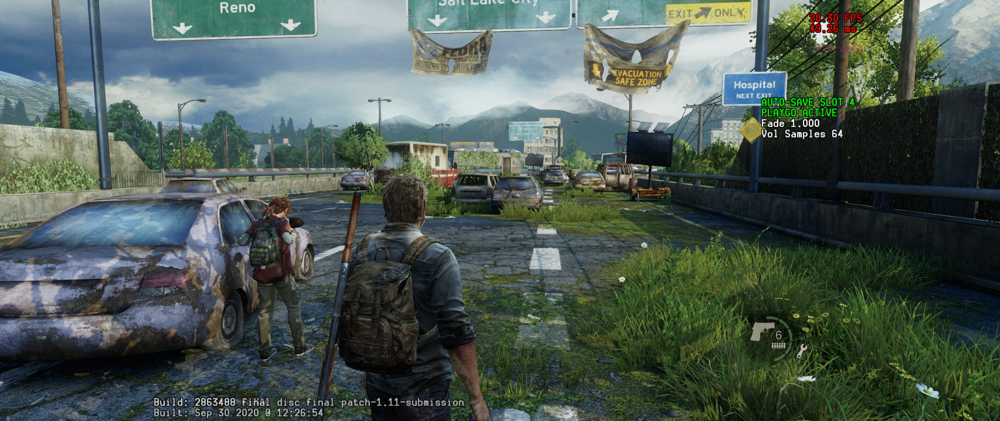
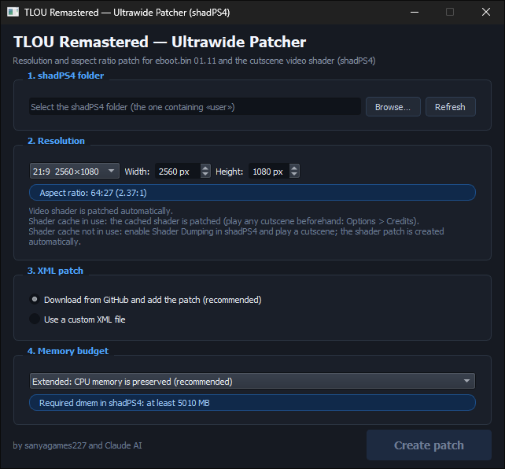
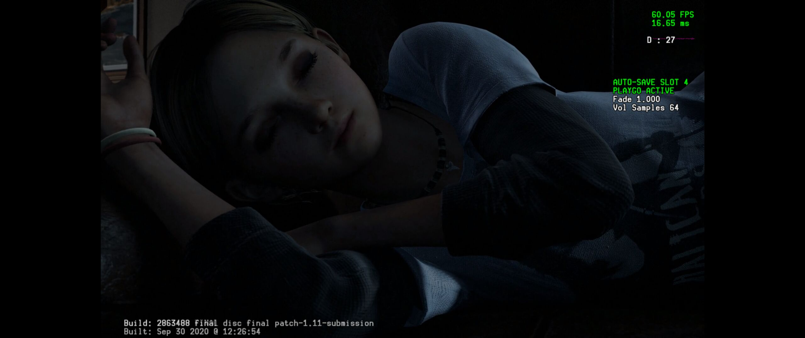

# TLOU Remastered — Ultrawide Patcher

Ultrawide / custom resolution support for *The Last of Us Remastered* (PS4 `01.11`) on [shadPS4](https://github.com/shadps4-emu/shadPS4).



The resolution patch is available directly in shadPS4 — **no extra steps needed** to get ultrawide working.

The only thing you need to do manually is **fix cutscenes** — by default they render at 16:9 and will appear stretched. This tool patches the video shader to fix that.

> The shader is taken from **your own copy of the game** — this repository does not distribute it.

## Main Window


---

## Fixing cutscenes



### Step 1 — Dump the shader from the game

1. In shadPS4 enable **Settings → GPU → Dump Shaders** ✓
2. Launch the game, go to **Options → Credits** and let it play for a few seconds (the credits are a cutscene).
3. Close the game. The dumped file is here:

```
<shadPS4 folder>/user/shader/dumps/cs_0x00000000562c4394_0.spv
```

### Step 2 — Patch it

Run the patcher, drop the dumped `.spv` into the **Shader** field, set your resolution, click **Create patch**.

### Step 3 — Install

Copy the output file to:
```
<shadPS4 folder>/user/shader/patch/cs_0x00000000562c4394_0.spv
```

Launch the game and cutscenes will display correctly.

> ⚠️ **Shader cache enabled in shadPS4?** Read the next section — the patched shader may be ignored on repeated launches.

---

## Shader cache workaround

**The problem.** With *shader cache* enabled in shadPS4, the emulator uses the patched shader from `user/shader/patch` only on the **first** launch. From the second launch on, it takes the **stock** shader from the cache, and cutscenes are stretched again. This is a shadPS4 bug.

**The workaround.** Until it is fixed in the emulator, the patcher can patch the shader **directly inside the shader cache** — either a folder or a ZIP archive (both are supported by shadPS4). It looks for the original video shader by file size and SHA-256 (so even a cache with thousands of files is scanned instantly) and replaces it in place.

### How to use

1. **Close the game and shadPS4.**
2. In the patcher, set your resolution and fill in the **Shader cache** field — click **Folder…** or **ZIP…** and select your shader cache.
3. Click **Create patch**.

The patcher will report what it found and patched. The original shader is saved to the `ShadPS4/backup` folder next to the patcher before anything is changed. ZIP archives are rebuilt safely: the result is verified first, and your original archive stays untouched if anything goes wrong.

For this you do not need a dumped `.spv` — the shader is taken from the cache itself. The **Shader** field is only needed if you also want the file for `user/shader/patch`.

### "Video shader not found in the cache"

The shader gets into the cache only after the game has played a cutscene. So:

1. Launch the game and start any cutscene — for example **Options → Credits**.
2. **Close the game completely.**
3. Run the patcher again with the same cache path.

### Notes

- Changed your resolution later? Just run the patcher again — an already patched shader in the cache is found and updated.
- For 16:9 resolutions the shader is not needed; if a previously patched one is found in the cache, it is reset to a neutral state.
- If a file is locked, the patcher will ask you to close the game and shadPS4.

---

## For enthusiasts / custom resolutions

The patcher also generates a full XML patch if you need a resolution not included in shadPS4's built-in patch. It adjusts memory budgets, aspect ratio, HUD, camera, crosshair, fonts, and interaction icons — everything needed for an arbitrary resolution.

**Requirements:** Python 3.8+, PyQt5 (`pip install PyQt5`)

```
python tlou_r_shadps4_ultrawide.py
```

The generated `<Metadata>` block goes into `TheLastOfUsRemastered.xml` in your shadPS4 patches folder, before the closing `</Patch>` tag.

Tested: 2240×960, 2560×1080, 3440×1440

The interface and patch descriptions are available in English, Russian and Ukrainian (detected from your system language, or set with `--lang`).

<details>
<summary>CLI usage</summary>

```
python tlou_r_shadps4_ultrawide.py --cli 2560 1080 \
    [--eboot eboot.bin] \
    [--xml base.xml out.xml] \
    [--spv in.spv out.spv] \
    [--cache DIR|ZIP] \
    [--dmem | --extra MB] \
    [--aggressive] \
    [--frac %] \
    [--keep-old] \
    [--lang en|ru|uk]
```

`--cache` patches the video shader inside the shadPS4 shader cache (folder or `.zip`). Exit code `3` means the shader was not found in the cache yet (play any cutscene first, see above).

</details>

---

> Not affiliated with Naughty Dog or Sony Interactive Entertainment. For personal/emulation use only.
